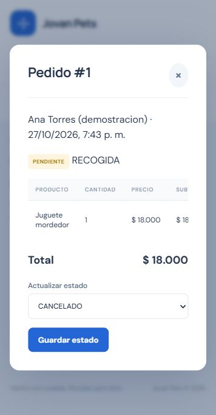

# Validación de la entrega

Fecha: 27 de octubre de 2026 (America/Bogota).

## Backend

Se ejecutó `clean verify` con Maven 3.9.11, JDK 21 y dependencias locales de la entrega anterior. Resultado: **BUILD SUCCESS; 10 pruebas, 0 fallos, 0 errores, 0 omitidas**. Persistencia de pruebas: H2 en memoria con modo PostgreSQL. No se usa esta prueba para afirmar compatibilidad certificada con un servidor PostgreSQL.

Pruebas de integración ejecutadas:

1. Sesión, CSRF y restricciones de roles.
2. Recalcular total, descontar existencias y devolverlas una sola vez al cancelar un pedido.
3. Revertir toda la compra si una línea carece de existencias.
4. Impedir que un cliente consulte la mascota de otro cliente.
5. Bloquear intervalos superpuestos por duración y liberarlos al cancelar una cita futura.
6. Impedir autoasignación de rol administrador durante registro público.
7. Dos compras concurrentes de la última unidad: una responde 200 y la otra 409; stock final cero.
8. Dos reservas concurrentes del mismo intervalo: una responde 200 y la otra 409.
9. Rechazar cancelación de cita pasada y conservar su estado original (nueva).
10. Rechazar producto con precio cero sin persistirlo (nueva).

El reporte de JUnit se conserva en `evidencia/TEST-FlujosIntegracionTest.xml`. No se copiaron el registro de consola completo ni bases locales al repositorio.

## Recorrido en navegador

Se inició el JAR construido en `http://localhost:8095`, con una base H2 en archivo distinta de las pruebas y de la demostración del usuario. La página y la API respondieron; `/api/estado` devolvió `disponible`.

Se inició sesión con la cuenta ficticia `cliente@jovanpets.test`. Se consultó la ficha de Luna, se abrió Tienda y se añadió una unidad de Juguete mordedor al carrito. El pedido de recogida se registró con identificador **#1**, estado **PENDIENTE** y total **$18.000**. La vista de detalle mostró producto, cantidad, precio y subtotal. Una consulta independiente a `/api/productos` confirmó que las existencias del producto pasaron de **12 a 11**. El navegador no registró errores ni advertencias de consola durante este recorrido.

No se procesó ningún pago ni se envió un pedido a un servicio externo. No se probaron todos los flujos visuales ni todos los navegadores; esta evidencia no sustituye una prueba exhaustiva de las 24 HU.

## Modelos de Visual Paradigm

El proyecto se generó con Visual Paradigm 18.1, build 20260838. Se guardó y volvió a abrir mediante la propia aplicación. Se exportaron y revisaron visualmente las tres imágenes:

| Diagrama nativo | Formas | Conectores |
|---|---:|---:|
| YourdonDeMarcoDFD: contexto | 8 | 8 |
| ComponentDiagram: funcional (revisión 28 de octubre) | 35 | 10 |
| ClassDiagram: lógica | 13 | 9 |

Los conteos de formas incluyen encabezados y leyendas. El modelo lógico tiene diez clases de dominio. No hay relaciones UML `Dependency` en el proyecto. La vista funcional conecta los puertos de seis componentes mediante cinco interfaces estructuradas, con cinco relaciones Realization y cinco Usage. No hay flechas UML Dependency entre cajas de componentes. Se conservaron las marcas de agua.

El motor de Visual Paradigm emitió avisos porque `wmic` no está disponible en este Windows. La generación terminó y el archivo VPP fue guardado, reabierto y exportado; el resultado se comprobó en `diagramas/validacion-modelo.txt`. Para la ejecución CLI se usaron preferencias efímeras en memoria, sin escribir al registro de Windows; no se modificó la licencia.

## Límites

HU-22 no está implementada. Otras HU tienen cobertura parcial, registrada en TRAZABILIDAD.md. No se ejecutó PostgreSQL real, una carga de rendimiento, respaldo automático, envío de correo, pago ni un nuevo despliegue público.

## Revisión gráfica del 28 de octubre

Se guardaron y reabrieron un proyecto completo con las tres vistas y un proyecto independiente de componentes. La vista funcional tiene seis componentes, diez puertos y cinco interfaces, con diez tramos nativos. Se comprobaron los contratos contra las cinco interfaces inyectadas en ApiControlador y se revisó visualmente la imagen exportada. Los resultados del backend pertenecen a la ejecución del 27 de octubre; no se volvió a ejecutar la suite porque esta revisión solo cambia el diagrama y su documentación.
